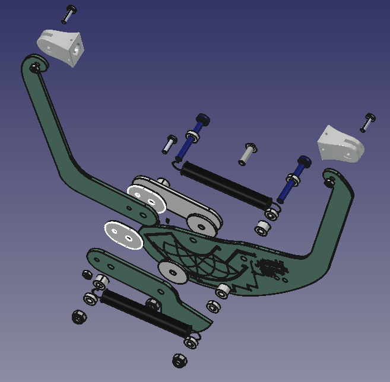
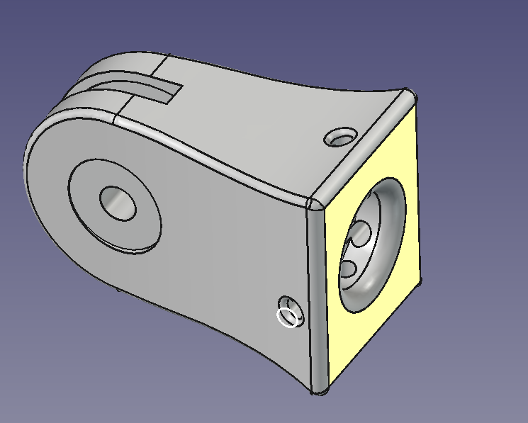
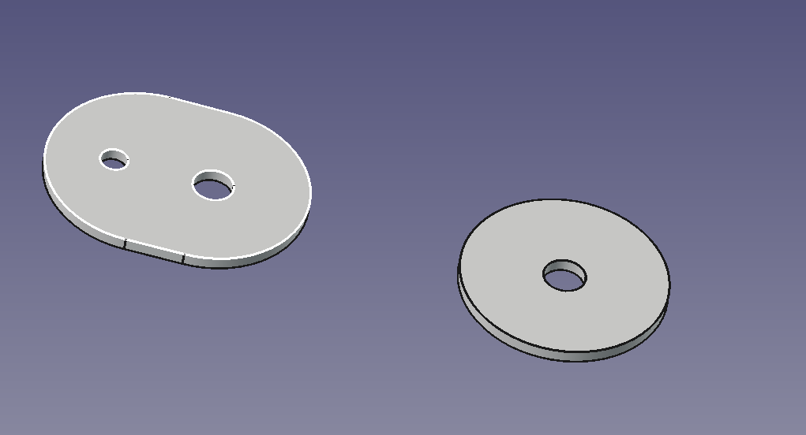

# 3D Models

Mechanical files for the inductive fruit gauge (plier).

Most of the gauge's structure is made of the PCBs themselves: FR4 is the circuit substrate and also the structural material of the arms. FR4 expands much less with temperature than the 3D-printed arms of earlier versions (α ≈ 1.2·10⁻⁵ K⁻¹), so less thermal compensation is needed. The only parts that are not PCBs are the PETG fruit clips, the PTFE spacers and standard hardware.

## Folder structure

### `Grubber/` — fruit clips (manufacture)

| File | Description |
| ---- | ----------- |
| `clippa acciaio armonico-Body_v.02.stl` | Printable fruit clip |
| `clippa acciaio armonico_v.02.FCStd` | FreeCAD source |

Each clip holds two spring-steel wires, locked with a self-tapping screw and bent into fingers that grip the fruit. Print the clips in **PETG**, which withstands outdoor use and is self-extinguishing. The clip length expands with temperature and is included in the thermal compensation, so enter it in the configuration software.

### `Teflon disks/` — PTFE spacers (manufacture)

| File | Description |
| ---- | ----------- |
| `Spessore_braccio.stl` / `.svg` | Arm spacer outline |
| `Spessore_centrale.stl` / `.svg` | Central spacer outline |
| `1.1mm_Spessore_braccio.nc` / `1.1mm_Spessore_centrale.nc` | CNC G-code toolpaths (1.1 mm cut depth) |

Cut them from a 1 mm PTFE sheet. The spacers go between the moving boards: they reduce friction and backlash so that the arms rotate freely and small diameter changes are not hidden by stiction.

### `Pliers cad files and renderings/` — reference only

STEP models of the gauge PCBs and the full assembly. Use them to understand how the parts fit together and to design enclosures or accessories. **Do not use them for manufacturing.** The PCBs are made from the Gerbers in [`Schematics and Gerbers/PCB pliers`](../Schematics%20and%20Gerbers/PCB%20pliers).

| File | Description |
| ---- | ----------- |
| `Piste.step` | Sensing arm (coils + electronics) |
| `Braccio.step` | Second arm |
| `Target.step` | Inductive target |
| `Spacer.step` | FR4 spacer |
| `All_outline.step` | Full assembly |
| `Rendering.FCStd` | FreeCAD assembly and rendering |

## Manufactured parts (per gauge)

| Part | Process | Material | Qty | File |
| ---- | ------- | -------- | --- | ---- |
| Fruit clip | 3D printing | PETG | 2 | `Grubber/clippa acciaio armonico-Body_v.02.stl` |
| Arm spacer | CNC / laser / knife | PTFE, 1 mm | 2 | `Teflon disks/Spessore_braccio.*` |
| Central spacer | CNC / laser / knife | PTFE, 1 mm | 2 | `Teflon disks/Spessore_centrale.*` |

The full list of screws, nuts, springs and wires is in the [building instructions](../building_instructions.md#12-fruit-gauge-per-gauge).
