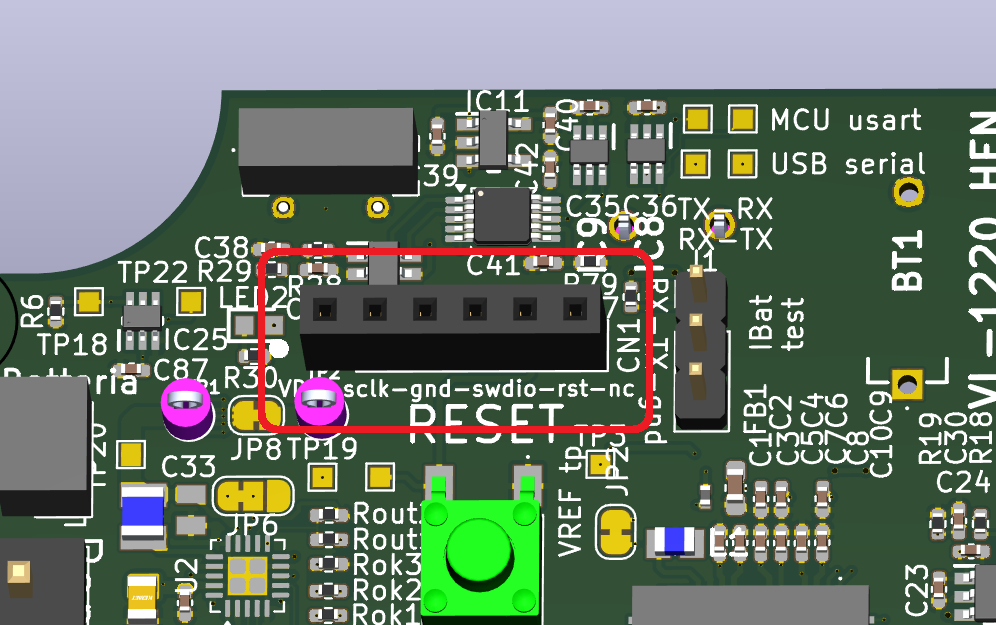

# Building Instructions

This guide explains how to build a complete Agro LoRa Inductive Fruit Gauge system: one sensor node and up to eight inductive fruit gauges (pliers).

**Contents**

1. [Materials and tools](#1-materials-and-tools)
2. [PCB manufacturing](#2-pcb-manufacturing)
3. [Sensor node firmware programming](#3-sensor-node-firmware-programming)
4. [LX3302A programming](#4-lx3302a-programming)
5. [Fruit gauge mechanical assembly](#5-fruit-gauge-mechanical-assembly)
6. [Wiring and final assembly](#6-wiring-and-final-assembly)
7. [Configuration and first start-up](#7-configuration-and-first-start-up)

---

## 1. Materials and tools

### 1.1 Sensor node (one per installation)

| Item | Description | Qty |
| ---- | ----------- | --- |
| Sensor node PCB | Assembled PCB from [`Schematics and Gerbers/PCB sensor node`](Schematics%20and%20Gerbers/PCB%20sensor%20node) | 1 |
| Li-ion battery | Single-cell Li-ion, JST PH 2-pin connector (the paper's energy budget is based on 800 mAh). Maximum charge voltage set by the BQ25570 to about 4.2 V | 1 |
| Solar panel | Small photovoltaic cell, 2-pin connector (J3). The BQ25570 cold-starts from 330 mV and harvests down to about 100 mV | 1 |
| RTC backup cell | Panasonic VL-1220 rechargeable coin cell (BT1), keeps the RTC running | 1 |
| LoRa antenna | 868 MHz antenna with U.FL connector (or pigtail to an external antenna) | 1 |
| Enclosure | Weather-resistant enclosure — **part number to be added** | 1 |

### 1.2 Fruit gauge (per gauge)

| Category | Item | Description / part number | Qty per gauge |
| -------- | ---- | ------------------------- | ------------- |
| PCB | Fruit gauge PCB set | From [`Schematics and Gerbers/PCB pliers`](Schematics%20and%20Gerbers/PCB%20pliers): 1 × `Piste` (assembled), 1 × `Braccio`, 1 × `TargetGrande`, 1 × `spacer` | 1 set |
| 3D-printed part | Fruit clip | `clippa acciaio armonico-Body_v.02.stl` in [`3d models/Grubber`](3d%20models/Grubber), printed in PETG | 2 |
| Mechanical material | PTFE sheet | 1 mm thick, cut to the shapes in [`3d models/Teflon disks`](3d%20models/Teflon%20disks) | 2 of each shape |
| Mechanical hardware | M2 × 8 mm screw | Pan head, Pozidriv, zinc-plated steel (DIN 7985). Fixes the clips to the arms. RS 908-7637 | 3 |
| Mechanical hardware | M2 nut | Hex nut, zinc-plated steel. RS 560-271 | 3 |
| Mechanical hardware | M3 × 25 mm screw | Central joint — **RS code to be added** | 3 |
| Mechanical hardware | M3 lock nut | Nylon-insert lock nut, A2 stainless steel (DIN 985). RS 521-917 | 3 |
| Mechanical hardware | Self-tapping screw | No. 2 × 6.5 mm, pan head, Pozidriv, A2 stainless steel (DIN 7981C). Locks the spring-steel wires in the clips. RS 287-4014 | 2 |
| Mechanical hardware | Extension spring | RS 751-770: wire Ø 0.63 mm, outer Ø 7 mm, length 35 mm (max. 101.5 mm), k = 0.16 N/mm, initial force 12.2 N | 2 |
| Mechanical hardware | Spring-steel (piano) wire | For the fruit-contact fingers — **diameter to be added** | 4 |
| Mechanical hardware | Heat-shrink tubing | Optional, softens the contact with the fruit skin | as needed |
| Cable | LAPP UNITRONIC® LiYY 4 × 0.25 mm² | LAPP 0028304, up to 5 m per gauge | as needed |
| Connector | Molex PicoBlade 4-pin housing + crimps | Mates with the 53398-0471 headers on the node | 1 |

The LAPP UNITRONIC® LiYY cable has PVC insulation, which holds up well outdoors (UV, moisture, dirt). The system was characterised with cables up to 5 m long.

### 1.3 Analog sensors (optional)

Up to four sensors with a 0–3.3 V output. For each one you need a Molex PicoBlade 3-pin housing (it mates with 53398-0371).

### 1.4 Tools and software

| Item | Purpose |
| ---- | ------- |
| ST-LINK (V2/V3) or SEGGER J-Link | SWD programming of the sensor node |
| [STM32CubeProgrammer](https://www.st.com/en/development-tools/stm32cubeprog.html) | Flashing the node firmware |
| Microchip [LXM9518](https://www.microchip.com/en-us/development-tool/lxm9518) programmer | Programming the LX3302A on each fruit gauge |
| Microchip IPCE (Integrated Programming and Calibration Environment) | Software for the LXM9518 |
| 3D printer (PETG) | Fruit clips |
| CNC mill / cutter or laser cutter suitable for PTFE | PTFE spacers |
| Crimping tool for Molex PicoBlade | Cable connectors |
| USB-C cable + Windows PC | Node configuration |

---

## 2. PCB manufacturing

Each Gerber package in [`Schematics and Gerbers`](Schematics%20and%20Gerbers) includes BOM and CPL (pick-and-place) files in the JLCPCB format (LCSC part numbers). These files can be uploaded directly to a PCB assembly service.

### 2.1 Sensor node PCB

Folder: [`Schematics and Gerbers/PCB sensor node/Gerber production files`](Schematics%20and%20Gerbers/PCB%20sensor%20node/Gerber%20production%20files)

* `GERBER-LoRa Pinze Sent.zip` — **6-layer**, 1.6 mm board
* `BOM-LoRa Pinze Sent.csv`, `CPL-LoRa Pinze Sent.csv` — order it **with assembly**

Some parts may not be available from the assembler and must be hand-soldered: the battery/solar/RTC-cell connectors, the debug headers and, depending on the service, the U.FL connector. Compare the BOM with the schematic before ordering.

### 2.2 Fruit gauge PCBs

Folder: [`Schematics and Gerbers/PCB pliers/gerber production files`](Schematics%20and%20Gerbers/PCB%20pliers/gerber%20production%20files)

| Package | Board | Assembly |
| ------- | ----- | -------- |
| `GERBER-Piste.zip` | Sensing arm: TX/RX coils, LX3302A, LMT01, MCP6541 | **Yes** — use `BOM-Piste.csv` and `CPL-Piste.csv` |
| `GERBER-Braccio.zip` | Second arm | No (bare board) |
| `GERBER-TargetGrande.zip` | Copper target | No (bare board) |
| `GERBER-spacer.zip` | FR4 spacer | No (bare board) |

All four are 2-layer FR4, 1.6 mm. The FR4 is also the structural material of the gauge, so do not change the board thickness.

> **Note:** the LMT01 (U1) has no LCSC code in `BOM-Piste.csv`. Source it separately if the assembler cannot provide it.

---

## 3. Sensor node firmware programming

Use the precompiled firmware in [`Firmware`](Firmware) (`RAK3172_Ver_1.0.0_2026-06-02.hex`). The STM32CubeIDE project is also available, but rebuilding is only needed if you want to change the firmware: a different toolchain or library version can change its behaviour.

### 3.1 SWD connector (CN1)

Pin 1 is marked on the PCB with a **white dot**.

| Pin | Signal | Notes |
| --- | ------ | ----- |
| 1 | `VDD` | Target voltage reference for the probe. Can be left unconnected if the node is powered by its battery |
| 2 | `SWCLK` | PA14 |
| 3 | `GND` | |
| 4 | `SWDIO` | PA13 |
| 5 | `NRST` | MCU reset |
| 6 | `NC` | Not connected |

*Figure 1. Connection of the programming probe to the sensor node PCB.*

### 3.2 Flashing with STM32CubeProgrammer

1. Power the node (battery connected).
2. Connect the probe to CN1 and to the PC.
3. Open STM32CubeProgrammer, select **ST-LINK** (or **J-LINK**), mode **SWD**, then press **Connect**.
4. Check that the device is detected as STM32WLxx.
5. Open **Erasing & Programming**, select the `.hex` file, tick **Verify programming** and press **Start Programming**.
6. When it finishes, press **Disconnect**, remove the probe and power-cycle the node.

<!-- TODO: add STM32CubeProgrammer screenshots (connection, file selection, programming) to Images/ and reference them here. -->

The firmware is configured for the **EU868** region with **ABP** activation. The LoRaWAN keys are set later with the configuration software (section 7). They do not need to be compiled into the firmware.

---

## 4. LX3302A programming

Each fruit gauge has a Microchip LX3302A inductive position sensor IC. Its EEPROM must be programmed with [`Firmware/lx3302a_config.txt`](Firmware/lx3302a_config.txt), which configures the coil interface and the SENT output, before the gauge is assembled.

### 4.1 Pads on the Piste board

The Piste board has two groups of pads:

| Group | Pad | Signal |
| ----- | --- | ------ |
| **Programming** | J1 | `VIN` (5 V) |
| | J9 | `GND` |
| | J8 | `IO1` (PWM) |
| | J7 | `IO2` (SENT) |
| | J6 | `IO3` (analog out) |
| **Cable** | J3 | `VIN` (5 V) |
| | J2 | `GND` |
| | J4 | `SENT` (IO2) |
| | J5 | Temperature (LMT01 pulse output) |

### 4.2 Programming procedure

1. Connect the LXM9518 to the PC and start IPCE.
2. Press the programming connector against the programming pads and **hold it firmly** for the whole procedure. A brief loss of contact will interrupt the communication.
3. Check that IPCE detects the LX3302A.
4. Load `lx3302a_config.txt`, check the parameters and write the EEPROM.
5. Read the configuration back to check it, then remove the connector.

<!-- TODO: add photos of the programming connector position and of the pads, and IPCE screenshots. -->

> A pogo-pin fixture is under development to make this step faster and more repeatable.

---

## 5. Fruit gauge mechanical assembly

The models are in [`3d models`](3d%20models).

### 5.1 PTFE spacers

The PTFE spacers sit between the moving boards. They reduce friction and backlash so that the arms rotate smoothly.

Cut a **1 mm PTFE sheet** to the two shapes in [`3d models/Teflon disks`](3d%20models/Teflon%20disks). Make **two of each** per gauge.

| Shape | Files |
| ----- | ----- |
| Arm spacer | `Spessore_braccio.stl` / `.svg` / `1.1mm_Spessore_braccio.nc` |
| Central spacer | `Spessore_centrale.stl` / `.svg` / `1.1mm_Spessore_centrale.nc` |

The `.svg` files work for laser/knife cutters. The `.nc` files are ready-made CNC toolpaths (cut depth 1.1 mm).

*Figure 2. PTFE spacer shapes.*

### 5.2 Fruit clips

1. Print **two** `clippa acciaio armonico-Body_v.02.stl` in **PETG** for each gauge.
2. Thread two spring-steel wires through the holes in each clip and lock them with a self-tapping screw.
3. Bend the wires into fingers that hold the fruit gently without squeezing it.
4. Optionally, cover the parts touching the fruit with heat-shrink tubing.

*Figure 3. PETG fruit clip.*

<!-- TODO: add a photo of the spring-steel wires installed and bent. -->

### 5.3 Assembly

*Figure 4. Exploded view of the fruit gauge.*

1. Lay out the Piste arm, the Braccio arm, the target and the FR4 spacer.
2. Place the PTFE spacers as shown in the exploded view.
3. Align the central holes and insert the M3 × 25 mm screws, then the M3 lock nuts.
4. Tighten just enough to remove backlash. The arms must still rotate freely: **too much friction hides the small diameter changes you want to measure.**
5. Fit the two extension springs that close the arms onto the fruit.
6. Mount the two PETG clips with the M2 × 8 mm screws and M2 nuts, then check that they face each other.
7. Open and close the gauge by hand across its whole range and check that it moves smoothly.

---

## 6. Wiring and final assembly

### 6.1 Fruit gauge cable

Solder the LAPP 4 × 0.25 mm² cable to the **cable pads** of the Piste board and crimp a 4-pin PicoBlade connector on the other end:

| Node connector pin (J9–J16) | Signal | Piste pad |
| --------------------------- | ------ | --------- |
| 1 | GND | J2 |
| 2 | Temperature | J5 |
| 3 | SENT | J4 |
| 4 | +5 V (switched) | J3 |

Note your wire colours here, so that every gauge is wired the same way: <!-- TODO: add LAPP wire colours --> *to be completed*.

Fruit gauge channels map to node connectors as follows: channel 1 → J9, channel 2 → J10, … channel 8 → J16.

### 6.2 Analog sensors

| Pin (J5–J8) | Signal |
| ----------- | ------ |
| 1 | +3.3 V switched supply |
| 2 | Analog input (0–3.3 V) |
| 3 | GND |

Analog channel 1 → J8, channel 2 → J7, channel 3 → J6, channel 4 → J5.

The inputs are protected with BAV199 diodes and 10 Ω series resistors, but they must not go above 3.3 V.

### 6.3 Power and antenna

* Battery → J2 (JST PH, pin 1 = +, pin 2 = GND). **Check the polarity:** battery leads are not standardised.
* Solar panel → J3 (pin 1 = +, pin 2 = GND).
* VL-1220 coin cell → BT1.
* Antenna → U.FL connector J4.

Mount the PCB in the enclosure and route the gauge cables through cable glands.

<!-- TODO: add a photo of the completed wiring. -->

---

## 7. Configuration and first start-up

1. Connect the node to the PC with a USB-C cable. The CH340E draws its power from USB, so the configuration link does not drain the battery.
2. Start the [configuration software](Configuring%20software), choose the COM port at **115200** baud and connect.
3. Press **Read data**, then set:
   * **Dev ADDR**, **Net. Session Key**, **App. Session Key**, **App. EUI** and **ADR**. These must match the device registered on your network server (ABP).
   * **DR** (0–5) and **TX interval** (seconds).
   * **Set time** to synchronise the RTC.
4. In **Set node config.**, enable the connected gauges and analog inputs and set:
   * the number of SENT samples to average and the thermal compensation parameters of each gauge (arm length, clip length, thermal expansion coefficients);
   * the number of samples and the pre-sampling time of each analog input.
5. Use the on-demand reading to check every gauge: raw value, temperature and diameter.
6. Disconnect USB. The node goes back to acquisition mode.
7. Add [`Firmware/Chirpstack_decoder.js`](Firmware/Chirpstack_decoder.js) to the device profile on your network server and check that uplinks arrive.

Checklist before installing the node in the field:

- [ ] Node powers up and the battery voltage is plausible
- [ ] Every connected gauge returns a valid SENT reading and temperature
- [ ] Analog inputs read the expected values
- [ ] Uplinks are received and decoded
- [ ] The solar panel charges the battery
